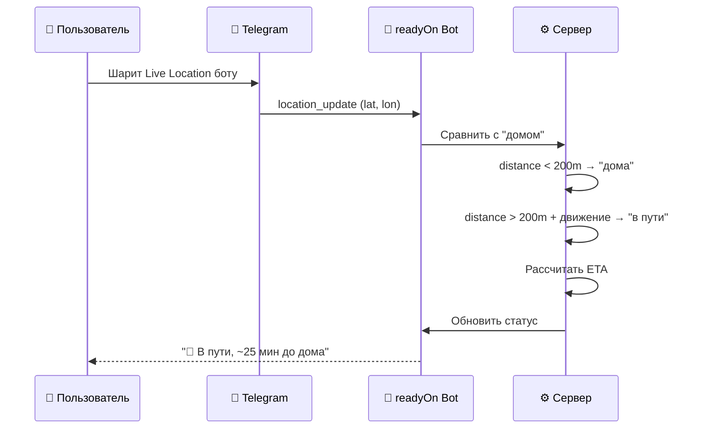
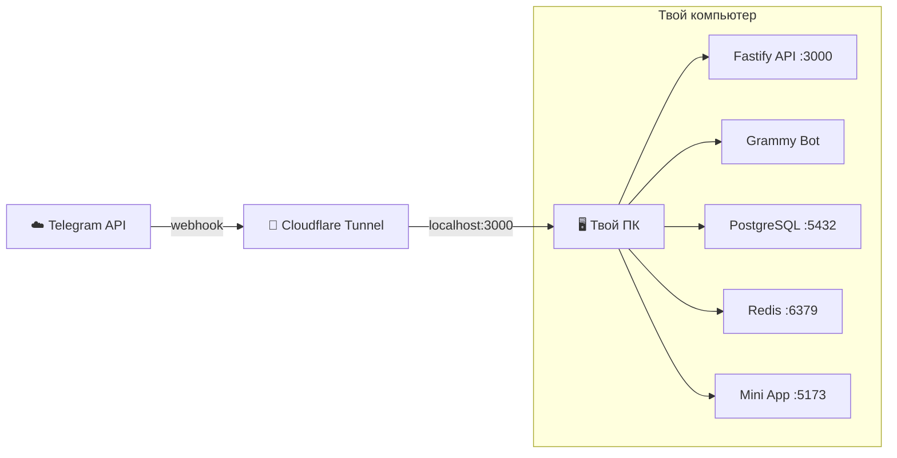
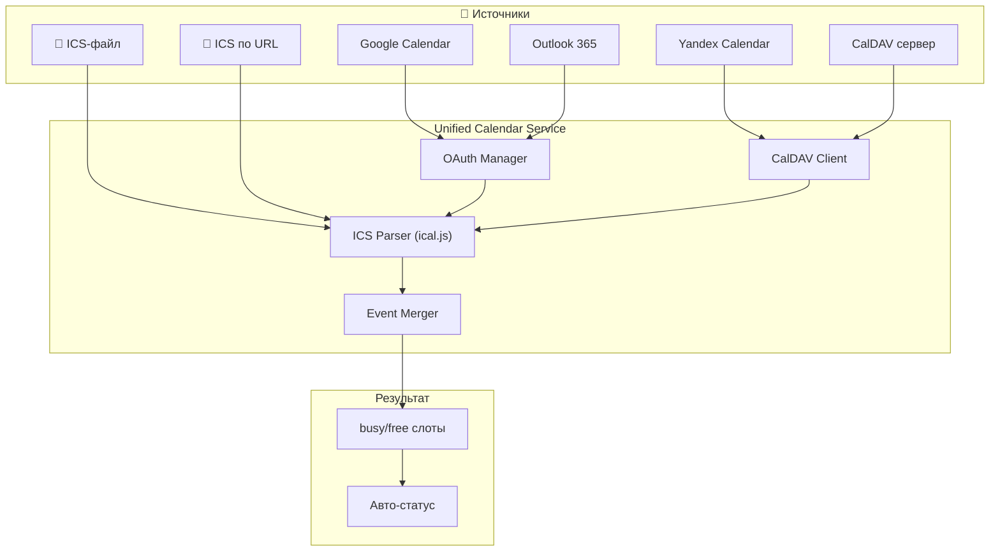
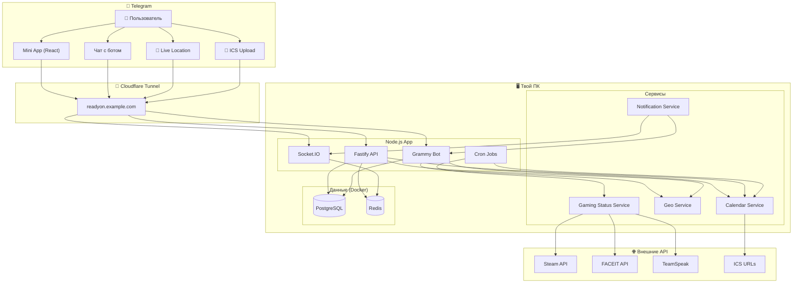

# readyOn — Архитектура v2

> Обновления: нативные инструменты Telegram, локальный хостинг, универсальные календари

---

## 1. 📲 Максимум из Telegram

Идея: **не изобретать велосипед** — Telegram уже умеет многое, используем это.

### Геолокация → Telegram Live Location

Вместо браузерного GPS в Mini App — используем **нативный механизм Telegram**:



**Как это работает:**
- Пользователь один раз шарит **Live Location** боту (на 1/8 часов или бессрочно)
- Telegram **сам** присылает обновления координат
- Сервер сравнивает с сохранённой точкой "дом" и вычисляет статус
- **Никакого дополнительного GPS-трекера не нужно**

| Что используем из Telegram | Вместо чего |
|---|---|
| 📍 Live Location → бот | ❌ Browser Geolocation API |
| 👤 Telegram авторизация | ❌ Своя система регистрации |
| 🔘 Inline-кнопки бота | ❌ Отдельный UI для быстрых действий |
| 🔗 Deep Links (`t.me/readyOnBot?start=group_ABC`) | ❌ Свои инвайт-ссылки на веб |
| 📋 Telegram Contact sharing | ❌ Поиск по никнеймам |
| 🖼 Telegram аватарка | ❌ Загрузка аватарок |
| 🔔 Bot messages | ❌ Push API / FCM |

### Бот — полноценный интерфейс, не просто дополнение

```
Пользователь пишет боту:
─────────────────────────────────────
🤖: Привет! Поставь статус на сегодня:

  [🟢 Готов]  [🟡 Может быть]  [🔴 Нет]

Пользователь нажимает 🟢:
─────────────────────────────────────
🤖: Во сколько будешь готов?

  [17:00] [18:00] [19:00] [20:00] [Другое]

Пользователь нажимает 19:00:
─────────────────────────────────────
🤖: ✅ Статус: Готов с 19:00

👥 Сейчас в "CS Пацаны":
  🟢 Ты — готов с 19:00
  🟢 Вася — готов с 18:00 🎮 в CS2
  🟡 Петя — маловероятно
  ⚪ Коля — не выставил
  ⚪ Дима — не выставил

  [📱 Открыть Mini App]  [🔄 Обновить]
```

---

## 2. 🖥 Локальный хостинг (первая версия)

Твой ПК = сервер. Для этого нужен **туннель**, чтобы Telegram мог достучаться до бота.

### Схема



### Варианты туннелей

| Туннель | Плюсы | Минусы |
|---------|-------|--------|
| **Cloudflare Tunnel** ✅ | Бесплатно, стабильно, свой домен | Нужен аккаунт Cloudflare |
| ngrok | Просто запустить | Бесплатно — рандомный URL, лимиты |
| localtunnel | Бесплатно, просто | Нестабильный |

> [!IMPORTANT]
> **Рекомендация: Cloudflare Tunnel** — бесплатный, стабильный, можно привязать домен `readyon.example.com`. Бот и Mini App будут работать через него.

### Docker Compose для локалки

```yaml
# docker-compose.dev.yml
services:
  postgres:
    image: postgres:16-alpine
    environment:
      POSTGRES_DB: readyon
      POSTGRES_USER: readyon
      POSTGRES_PASSWORD: readyon_dev
    ports:
      - "5432:5432"
    volumes:
      - pgdata:/var/lib/postgresql/data

  redis:
    image: redis:7-alpine
    ports:
      - "6379:6379"

volumes:
  pgdata:
```

- Backend + Bot + Mini App запускаем через `turbo dev` на хосте
- PostgreSQL и Redis — в Docker
- Cloudflare Tunnel пробрасывает наружу

> [!TIP]
> Когда будешь готов к продакшн-деплою, просто перенесём всё на VPS — Docker Compose уже будет готов, добавим сервисы для backend и frontend.

---

## 3. 📅 Универсальные календари

Не только Google — поддерживаем **любой** календарь.

### Поддерживаемые источники

| Источник | Метод | Приоритет |
|----------|-------|-----------|
| **ICS-файл** | Загрузка файла боту | 🟢 Фаза 1 — проще всего |
| **ICS по URL** | Подписка по ссылке (авто-обновление) | 🟢 Фаза 1 |
| **Google Calendar** | OAuth 2.0 | 🟡 Фаза 2 |
| **Yandex Calendar** | CalDAV или ICS-экспорт | 🟡 Фаза 2 |
| **Outlook / Microsoft 365** | Microsoft Graph API | 🟠 Фаза 3 |
| **Apple Calendar (iCloud)** | CalDAV | 🟠 Фаза 3 |
| **Любой CalDAV-сервер** | CalDAV протокол | 🟠 Фаза 3 |

### Архитектура: Unified Calendar Service



**Ключевая идея:** всё приводим к единому формату ICS (RFC 5545), а дальше один парсер извлекает busy/free слоты.

### ICS — как это работает для пользователя

**Вариант A: Загрузка файла**
```
Пользователь отправляет .ics файл боту
─────────────────────────────────────
🤖: 📅 Загружен календарь: 12 событий
    Ближайшее: "Пары" сегодня 14:00–17:30
    Статус обновлён: занят до 17:30

    [🔄 Загрузить новый] [❌ Отключить]
```

**Вариант B: Подписка по URL**
```
/calendar subscribe https://calendar.google.com/...ical
─────────────────────────────────────
🤖: 📅 Подписка подключена!
    Обновление: каждые 15 минут
    Найдено событий на сегодня: 3

    [⏱ Частота обновления] [❌ Отписаться]
```

> [!NOTE]
> **Почти любой календарь** умеет экспортировать ICS-ссылку: Google Calendar, Yandex, Outlook, Apple — у всех есть "Получить ссылку iCal". Это **универсальный** способ без OAuth.

---

## 📐 Обновлённая архитектура



---

## 📁 Обновлённая структура проекта

```
readyOn/
├── apps/
│   ├── web/                        # Telegram Mini App
│   │   └── src/
│   │       ├── components/
│   │       ├── pages/
│   │       ├── hooks/
│   │       ├── stores/             # Zustand
│   │       └── lib/                # API client, socket
│   │
│   └── server/
│       └── src/
│           ├── routes/             # REST API
│           ├── bot/                # Grammy handlers
│           │   ├── commands/       # /start, /ready, /group...
│           │   ├── callbacks/      # Inline-кнопки
│           │   └── handlers/       # Location, файлы
│           ├── services/
│           │   ├── calendar/       # Unified Calendar Service
│           │   │   ├── ics-parser.ts
│           │   │   ├── ics-subscriber.ts
│           │   │   ├── google-provider.ts    # (фаза 2)
│           │   │   └── caldav-provider.ts    # (фаза 3)
│           │   ├── geo/            # Геолокация
│           │   │   ├── location-tracker.ts
│           │   │   └── eta-calculator.ts
│           │   ├── gaming/         # Игровые статусы
│           │   │   ├── steam.ts
│           │   │   ├── faceit.ts
│           │   │   └── teamspeak.ts
│           │   ├── status/         # Daily status logic
│           │   └── notification/   # Notification engine
│           ├── cron/               # Scheduled jobs
│           ├── websocket/          # Socket.IO
│           └── db/
│               └── prisma/
│                   └── schema.prisma
│
├── packages/
│   └── shared/                     # Общие типы
│
├── docker-compose.dev.yml          # PG + Redis
├── turbo.json
└── package.json
```

---

## 🔄 Что изменилось vs v1

| Было (v1) | Стало (v2) | Почему |
|-----------|------------|--------|
| Browser Geolocation | Telegram Live Location | Нативно, надёжнее, экономит батарею |
| Google Maps API для ETA | Расчёт по расстоянию + опционально Maps | Проще для MVP, без платного API |
| Только Google Calendar | ICS-файл → ICS-URL → OAuth провайдеры | Универсально, работает с любым календарём |
| Деплой на Railway | Локально на ПК + Cloudflare Tunnel | Бесплатно, контроль, потом мигрируем |
| Бот как дополнение | Бот как полноценный интерфейс | Всё можно сделать и из бота, и из Mini App |
