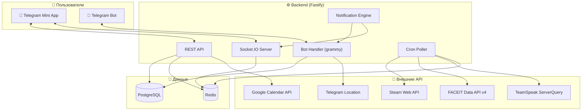
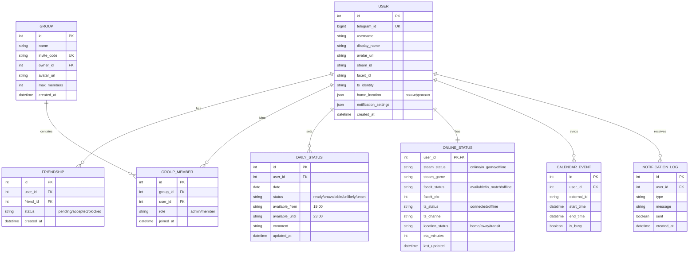

# readyOn — План разработки

## ✅ Принятые решения

| Вопрос | Решение |
|--------|---------|
| Платформа | **Telegram Mini App + Telegram Bot** (двойной интерфейс) |
| GPS-приватность | Только статус: дома / не дома / в пути ~N мин |
| TeamSpeak | Свой сервер, интеграция через ServerQuery |
| Уведомления | Настраиваемые + ремайндеры поставить статус |
| Масштаб | Публичный сервис, система друзей и инвайтов |
| Деплой | Облачный хостинг (Railway/Render), позже — VPS |

---

## 🛠 Стек технологий

| Слой | Технология | Почему |
|------|-----------|--------|
| **Frontend** | React 19 + TypeScript + Vite | Быстрая сборка, типизация |
| **UI-kit** | Tailwind CSS + shadcn/ui | Гибкий, тёмная тема из коробки |
| **Telegram Mini App** | `@telegram-apps/sdk-react` | Официальный SDK |
| **Telegram Bot** | `grammy` | Современный, TypeScript-first |
| **Backend** | Node.js + Fastify | Быстрее Express, схемы валидации |
| **Real-time** | Socket.IO | Авто-реконнект, rooms |
| **ORM** | Prisma | Type-safe, миграции |
| **БД** | PostgreSQL | Надёжность, JSON-поля |
| **Кэш** | Redis | Онлайн-статусы, сессии |
| **Cron** | node-cron | Опрос API интеграций |
| **Деплой** | Railway (старт) → VPS (масштаб) | Простой старт, потом контроль |

---

## 📐 Архитектура



---

## 🗄 Модель данных



---

## 🤖 Telegram Bot — команды и сценарии

### Основные команды
| Команда | Описание |
|---------|----------|
| `/start` | Регистрация + приветствие |
| `/status` | Посмотреть статусы друзей/группы |
| `/ready 19:00` | Установить "готов с 19:00" |
| `/busy` | Установить "сегодня не могу" |
| `/maybe` | Установить "маловероятно" |
| `/group` | Управление группами |
| `/invite @username` | Добавить друга |
| `/settings` | Настройка уведомлений |
| `/link steam <id>` | Привязать Steam |
| `/link faceit <nickname>` | Привязать FACEIT |

### Inline-кнопки (быстрые действия)
Бот присылает вечерний ремайндер с кнопками:
```
🟢 Готов    🟡 Может быть    🔴 Не сегодня
```

### Уведомления (настраиваемые)
| Событие | По умолчанию |
|---------|-------------|
| Ремайндер "поставь статус" | ✅ 16:00 (настраивается) |
| Друг поставил 🟢 | ✅ Вкл |
| Все в группе готовы | ✅ Вкл |
| Друг зашёл в CS2 | ⬜ Выкл |
| Друг в TeamSpeak | ⬜ Выкл |

---

## 📱 Mini App — экраны

### 1. Главный дашборд
```
┌──────────────────────────────┐
│  readyOn              ⚙️    │
│──────────────────────────────│
│  Твой статус сегодня:        │
│  [🟢 Готов] [🟡 Мб] [🔴 Нет] │
│  С ___:___ до ___:___        │
│  Комментарий: ____________   │
│──────────────────────────────│
│  👥 Squad "CS Пацаны" (4/5)  │
│                              │
│  🟢 Вася    готов с 19:00    │
│     🎮 Steam: в CS2          │
│     🎧 TS: Lobby             │
│                              │
│  🟡 Петя    мб поздно       │
│     📅 Занят до 20:00        │
│     📍 в пути ~25 мин        │
│                              │
│  🔴 Коля    не сегодня       │
│                              │
│  ⚪ Дима    не выставил      │
│     🎮 Steam: оффлайн        │
│──────────────────────────────│
│  [Дашборд] [Группы] [Друзья] │
└──────────────────────────────┘
```

### 2. Профиль и привязки
- Привязка Steam, FACEIT, TeamSpeak
- Подключение Google Calendar
- Настройка геолокации (вкл/выкл)
- Настройка дома (адрес для расчёта ETA)

### 3. Группы
- Создание группы, инвайт-ссылка
- Список участников и их статусы
- Настройки группы (игра по умолчанию, время напоминания)

### 4. Друзья
- Поиск по Telegram-юзернейму
- Список друзей с мини-статусами
- Входящие/исходящие запросы

---

## 🔌 Интеграции — детали

### Steam Web API
- **Endpoint:** `ISteamUser/GetPlayerSummaries`
- **Данные:** personastate (online/offline/busy/away), gameid, gameextrainfo
- **Опрос:** каждые 60 сек для активных пользователей
- **API Key:** нужен Steam Web API Key

### FACEIT Data API v4
- **Endpoint:** `/players/{player_id}`
- **Данные:** статус, ELO, уровень, текущий матч
- **Опрос:** каждые 2 мин
- **Auth:** API Key (серверный)

### TeamSpeak ServerQuery
- **Протокол:** TCP (порт 10011) или SSH
- **Данные:** список клиентов, каналы, статус мута
- **Опрос:** каждые 30 сек
- **Нужно:** логин/пароль ServerQuery + IP сервера

### Google Calendar
- **Auth:** OAuth 2.0
- **Endpoint:** `CalendarList`, `Events`
- **Данные:** busy/free слоты на сегодня
- **Опрос:** каждые 5 мин или Webhook (push notifications)

### Геолокация
- **Источник:** Telegram Location Sharing (бот)
- **Расчёт:** расстояние от "дома" → статус (дома / не дома / в пути)
- **ETA:** Google Maps Directions API или простой расчёт по расстоянию
- **Приватность:** хранится только статус + ETA, не координаты

---

## 📁 Структура проекта

```
readyOn/
├── apps/
│   ├── web/                    # Telegram Mini App (React)
│   │   ├── src/
│   │   │   ├── components/     # UI компоненты
│   │   │   ├── pages/          # Экраны (Dashboard, Groups, Friends, Profile)
│   │   │   ├── hooks/          # React hooks
│   │   │   ├── services/       # API клиент, Socket.IO
│   │   │   ├── stores/         # Состояние (Zustand)
│   │   │   └── types/          # TypeScript типы
│   │   ├── index.html
│   │   ├── tailwind.config.ts
│   │   └── vite.config.ts
│   │
│   └── server/                 # Backend
│       ├── src/
│       │   ├── routes/         # API роуты
│       │   ├── bot/            # Telegram bot (grammy)
│       │   ├── integrations/   # Steam, FACEIT, TS3, Calendar
│       │   ├── services/       # Бизнес-логика
│       │   ├── cron/           # Периодические задачи
│       │   ├── websocket/      # Socket.IO handlers
│       │   ├── db/             # Prisma schema + migrations
│       │   └── utils/          # Хелперы
│       └── prisma/
│           └── schema.prisma
│
├── packages/
│   └── shared/                 # Общие типы и утилиты
│
├── docker-compose.yml          # PostgreSQL + Redis (dev)
├── turbo.json                  # Monorepo config
├── package.json
└── README.md
```

---

## 🗺 Roadmap — фазы разработки

### Фаза 1: Фундамент 🏗
> Базовый бот + Mini App с ручными статусами

- [ ] Настройка monorepo (Turborepo)
- [ ] Telegram Bot: `/start`, регистрация
- [ ] Prisma схема + миграции (User, DailyStatus, Group)
- [ ] Mini App: авторизация через Telegram
- [ ] Mini App: установка статуса (🟢🟡🔴)
- [ ] Bot: `/ready`, `/busy`, `/maybe` + inline-кнопки
- [ ] API: CRUD статусов
- [ ] Docker Compose для PostgreSQL + Redis

### Фаза 2: Социальная 👥
> Друзья, группы, дашборд

- [ ] Система друзей (запросы, принятие, удаление)
- [ ] Группы (создание, инвайт-ссылки, участники)
- [ ] Mini App: дашборд со статусами группы
- [ ] Mini App: экран друзей и групп
- [ ] Bot: `/group`, `/invite`
- [ ] Real-time обновления через Socket.IO

### Фаза 3: Игровые интеграции 🎮
> Steam, FACEIT, TeamSpeak

- [ ] Привязка Steam аккаунта
- [ ] Poller: опрос Steam API → онлайн-статусы
- [ ] Привязка FACEIT аккаунта
- [ ] Poller: опрос FACEIT API
- [ ] Подключение к TeamSpeak ServerQuery
- [ ] Poller: опрос TS3
- [ ] Mini App: отображение онлайн-статусов на карточках
- [ ] Redis-кэширование статусов

### Фаза 4: Календарь и геолокация 📅📍
> Smart-статусы на основе данных

- [ ] OAuth 2.0 для Google Calendar
- [ ] Sync событий → автоматический статус "занят до XX:XX"
- [ ] Геолокация через Telegram (бот)
- [ ] Расчёт "дома / не дома / в пути ~N мин"
- [ ] Google Maps Directions API для ETA

### Фаза 5: Уведомления 🔔
> Настраиваемая система уведомлений

- [ ] Движок уведомлений
- [ ] Ремайндер "поставь статус" (настраиваемое время)
- [ ] "Друг готов играть" / "Все готовы!"
- [ ] Mini App: экран настроек уведомлений
- [ ] Bot: `/settings`

### Фаза 6: Полировка и деплой 🚀
> Продакшн

- [ ] Деплой на Railway (или VPS)
- [ ] CI/CD через GitHub Actions
- [ ] Мониторинг и логирование
- [ ] Лендинг-страница
- [ ] Публикация бота (@readyOnBot)
- [ ] Onboarding-флоу для новых пользователей

---

> [!TIP]
> **MVP (фазы 1-2)** можно запустить за 2-3 недели — это уже рабочий продукт, которым можно пользоваться. Интеграции и smart-фичи подключаем итеративно.
