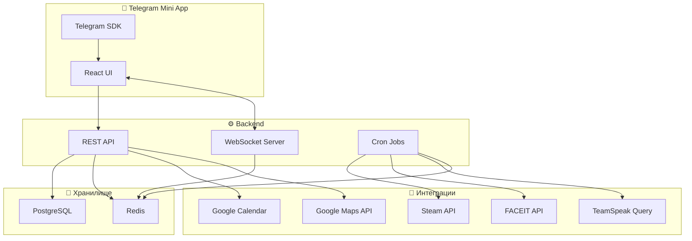

# readyOn — Концепция проекта

> **readyOn** — приложение для гейминг-компании, которое показывает кто готов играть, когда и откуда, без спама "кс?" в чат.

---

## 🎯 Проблема

Группа друзей каждый день решает один и тот же вопрос: *"Кто сегодня играет?"*. Это превращается в десятки сообщений "кс?", "во сколько?", "я хз, может попозже" в Telegram. Нужен инструмент, который **автоматически** собирает информацию и показывает картину в одном месте.

---

## 🧩 Ключевые фичи

### 1. 🟢 Статус готовности (ручной)
Каждый игрок выставляет свой статус на сегодня:

| Статус | Иконка | Описание |
|--------|--------|----------|
| **Готов** | 🟢 | "Готов играть с 19:00" (указывается время) |
| **Не могу** | 🔴 | "Сегодня никак" |
| **Маловероятно** | 🟡 | "Либо поздно, либо никак" |
| **Не определился** | ⚪ | Пока не выставил статус |

- Статусы сбрасываются каждый день автоматически
- Можно добавить комментарий: "после универа", "дз делаю, мб к 22"
- Push-уведомление напоминает выставить статус (например, в 16:00)

### 2. 📅 Интеграция с календарём (Google Calendar)
- Подтягивает занятость из Google Calendar
- Если есть событие — автоматически показывает "занят до XX:XX"
- Подсказывает свободные окна: "свободен с 20:00"
- Можно скрыть названия событий (приватность)

### 3. 🎮 Онлайн-статусы (Steam, FACEIT, TeamSpeak)

#### Steam
- Показывает: онлайн / в игре (какой) / оффлайн / последний раз в сети
- Если уже в CS — показывает "🎮 Сейчас в CS2"

#### FACEIT
- Показывает: в поиске / в матче / оффлайн
- Текущий ELO и уровень (опционально)

#### TeamSpeak
- Показывает: подключён к серверу / в каком канале / мут
- Если в TS — значит скорее всего уже готов

### 4. 👥 Друзья и группа
- Создаётся **группа** (комната), друзья присоединяются по ссылке-инвайту
- Дашборд показывает всех участников и их статусы в одном месте
- Карточка игрока: аватарка, статус, время готовности, онлайн-платформы, ETA до дома

### 5. 📍 Геолокация и ETA (опционально)
- Показывает: дома / не дома / в пути
- Если в пути — расчётное время до дома (через Google Maps API)
- **Приватность:** показывается только статус ("в пути, ~30 мин"), не координаты
- Каждый сам решает, включать ли геолокацию

---

## 🏗 Варианты платформы

### Вариант A: Telegram Mini App (рекомендуется)
```
+ Уже сидите в Telegram — не нужно отдельное приложение
+ Telegram WebApp API даёт доступ к геолокации
+ Авторизация через Telegram — без регистрации
+ Можно слать уведомления через Telegram-бота
+ Легко шарить инвайт-ссылку в чат
- Ограничения UI по сравнению с полноценным вебом
```

### Вариант B: PWA (Progressive Web App)
```
+ Полный контроль над UI/UX
+ Работает как приложение на телефоне и ПК
+ Геолокация через браузер
+ Push-уведомления
- Нужна отдельная авторизация
- Ещё одно приложение
```

### Вариант C: Telegram-бот
```
+ Максимально просто
+ Нативно в Telegram
- Ограниченный UI (кнопки и текст)
- Сложно показать дашборд со всеми статусами
```

> [!IMPORTANT]
> **Рекомендация:** Telegram Mini App — лучший баланс. Живёт прямо в Telegram, не нужна отдельная регистрация, и при этом полноценный веб-интерфейс.

---

## 🛠 Предварительный стек технологий

| Слой | Технология |
|------|-----------|
| **Frontend** | React + TypeScript + Tailwind CSS |
| **Telegram Mini App** | `@telegram-apps/sdk` |
| **Backend** | Node.js + Express / Fastify |
| **Real-time** | WebSocket (Socket.IO) |
| **База данных** | PostgreSQL + Prisma ORM |
| **Кэш/сессии** | Redis |
| **Авторизация** | Telegram WebApp Auth |
| **API интеграции** | Steam Web API, FACEIT API, TS3 ServerQuery |
| **Календарь** | Google Calendar API |
| **Геолокация** | Telegram Location / Google Maps API |
| **Деплой** | VPS (Hetzner/DigitalOcean) или Railway |

---

## 📐 Архитектура (высокий уровень)



---

## ❓ Открытые вопросы для обсуждения

1. **Платформа:** Telegram Mini App, PWA или бот? Или комбо (Mini App + бот для уведомлений)?
2. **Приватность GPS:** Достаточно ли статуса "дома / не дома / в пути ~30мин", или нужна карта?
3. **TeamSpeak:** У вас свой сервер или арендованный? (нужен доступ к ServerQuery)
4. **Уведомления:** Когда уведомлять? "Все 5 готовы — собираемся!", "Вася выставил статус 🟢"?
5. **Масштаб:** Только ваша компания или хотите делать публичный сервис?
6. **Деплой:** Есть ли уже сервер/VPS, или нужен?
